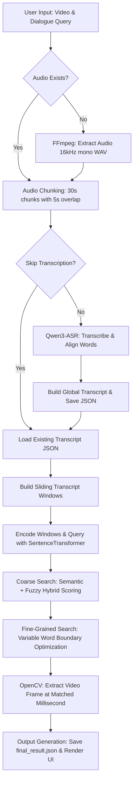

# Quest1: Video Dialogue Localization — Workflow & Architecture

This document provides a comprehensive end-to-end breakdown of how the Quest1 system operates when a user submits a dialogue query to locate it within a video.

---

## High-Level Overview

Given an input video file (or URL) and a target line of dialogue (e.g. *"My mind rebels at stagnation"*), the system:
1. Extracts and chunks the video's audio track.
2. Performs Automatic Speech Recognition (ASR) with word-level forced alignment using **Qwen3-ASR**.
3. Aggregates and normalizes word timestamps across the entire video.
4. Performs a hybrid **Semantic + Fuzzy search** using `sentence-transformers` and `rapidfuzz` to locate the exact dialogue match (even if paraphrased or containing ASR misspellings).
5. Refines the exact start/end word boundaries using a fine-grained sliding window.
6. Extracts the exact video frame image corresponding to the start timestamp using OpenCV.
7. Packages and presents the results (timestamp, frame image, match scores, raw JSON).

---

## End-to-End Execution Flowchart



---

## Detailed Step-by-Step Workflow

### Phase 1: Input & Configuration Setup
- **User Actions**:
  - **CLI Mode**: Runs `python -m src.pipeline --dialogue "..."`
  - **Web UI Mode**: Launches `python -m streamlit run app.py` (or via `./run_app.ps1`), enters a URL or uses `data/video.mp4`, types the dialogue line, and clicks **Run Pipeline**.
- **System Initialization**:
  - Validates paths defined in `src/config.py` (`data/video.mp4`, `data/audio.wav`, `outputs/`).
  - Resolves optional flags like `--skip-transcription` to bypass re-transcribing known videos.

---

### Phase 2: Audio Preprocessing & Chunking
1. **Audio Extraction (`utils.extract_audio`)**:
   - If `data/audio.wav` is missing, the system invokes `ffmpeg` as a subprocess to extract a high-fidelity 16kHz single-channel mono PCM WAV file from the video.
2. **Audio Chunking (`utils.split_audio`)**:
   - Long videos can exceed GPU memory during transcription. The system divides `audio.wav` into 30-second audio segments with a 5-second overlap between adjacent chunks.
   - *Why overlap?* Words spoken across chunk boundaries are guaranteed to be captured fully within at least one chunk.

---

### Phase 3: Automatic Speech Recognition (ASR) & Alignment
1. **Model Loading (`transcription.load_qwen_model`)**:
   - Loads the **Qwen3-ASR-1.7B** model onto CUDA GPU (or CPU fallback).
2. **Chunk Transcription (`transcription.transcribe_chunks`)**:
   - Processes audio chunks sequentially through Qwen3-ASR's forced aligner.
   - For every word spoken, Qwen3-ASR returns the precise start time (`start_time`) and end time (`end_time`) relative to that chunk.
3. **Global Transcript Assembly (`transcription.build_global_transcript`)**:
   - Offsets each chunk's relative timestamps by the chunk's global start time.
   - Merges and deduplicates overlapping words across chunk boundaries.
   - Formats every word into a standardized dictionary:
     `{"text": "rebels", "start_ms": 12450, "end_ms": 12890, "chunk_index": 0}`
4. **Persistence (`transcription.save_transcript`)**:
   - Writes the global word transcript to `outputs/qwen_results/qwen_transcript.json`.

---

### Phase 4: Dialogue Localization & Hybrid Search
1. **Sliding Window Construction (`matching.build_transcript_windows`)**:
   - Groups consecutive transcript words into overlapping candidate phrases (default: 10-word windows with a 2-word stride).
   - Computes normalized text versions (lowercased, stripped of punctuation).
2. **Semantic Embedding (`matching.DialogueMatcher`)**:
   - Encodes all transcript window texts into 384-dimensional vector embeddings using `sentence-transformers/all-MiniLM-L6-v2`.
   - Encodes the user's input query into the same vector space.
3. **Coarse Hybrid Scoring (`matching.combined_search`)**:
   - **Semantic Score (Cosine Similarity)**: Measures contextual and conceptual similarity (handles paraphrased dialogue).
   - **Fuzzy Score (Levenshtein Distance)**: Measures string similarity via `rapidfuzz` (handles ASR spelling errors).
   - **Combined Score**:
     $$\text{Combined Score} = 0.7 \times \text{Semantic Score} + 0.3 \times \text{Fuzzy Score}$$
4. **Fine-Grained Span Refinement (`matching.fine_grained_search`)**:
   - Takes the top candidate window and tests sub-spans of varying word lengths around it.
   - Isolates the exact start word and end word corresponding to the input dialogue, yielding the precise `start_ms` and `end_ms`.

---

### Phase 5: Frame Extraction & Result Delivery
1. **Video Frame Extraction (`utils.extract_frame_at_timestamp`)**:
   - Uses OpenCV (`cv2.VideoCapture`) to navigate to millisecond `start_ms`.
   - Reads the image frame, computes its exact frame index number, and saves the image to `outputs/dialogue_frame.jpg`.
2. **Output Formatting**:
   - Generates the final output structure:
     ```json
     {
       "input_dialogue": "My mind rebels at stagnation",
       "matched_dialogue": "my mind rebels at stagnation",
       "timestamp": "00:01:24.500",
       "start_ms": 84500,
       "end_ms": 87200,
       "semantic_score": 0.965,
       "fuzzy_score": 0.981,
       "combined_score": 0.970,
       "frame_number": 2028,
       "frame_timestamp_ms": 84500,
       "frame_path": "outputs/dialogue_frame.jpg"
     }
     ```
3. **Presentation**:
   - Writes to `outputs/final_result.json`.
   - Displays the extracted frame image, timestamp badge, confidence scores, and raw JSON response to the user via the CLI or Streamlit UI.
